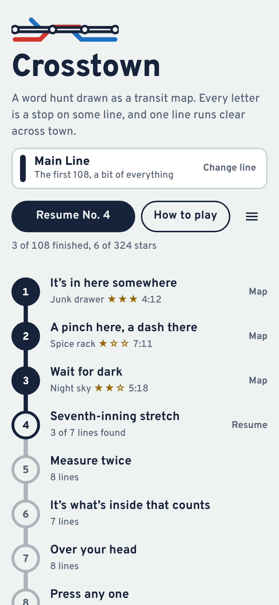
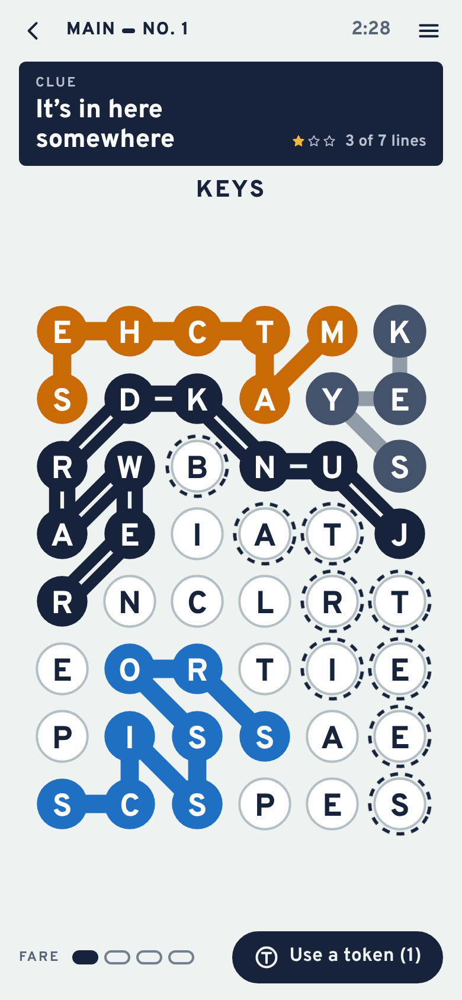
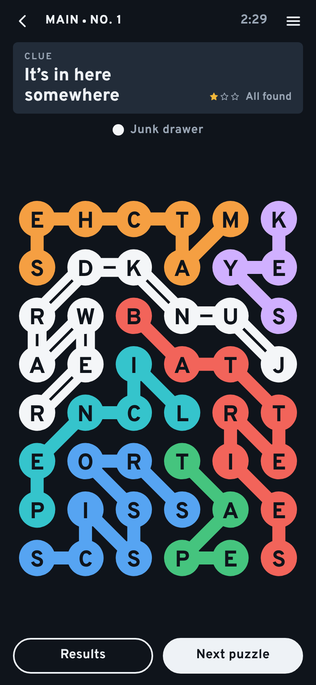

# Crosstown

**Play it: [crosstown.junkdrawer.works](https://crosstown.junkdrawer.works/)**

**A word hunt drawn as a transit map.** Every letter is a stop, and each theme word you find becomes its own coloured line. One line, the Crosstown, names the theme and runs from one edge of the map to the opposite edge. When you're done, every stop is on a line and the board looks like a subway map.

<p align="center">
  
  &nbsp;
  
  &nbsp;
  
</p>

## How it plays

- **Find the lines.** Trace a word from stop to stop in any direction, diagonals included. Drag across the letters, or tap them one at a time and tap the last one again. Arrow keys and Enter work too. A line can be a phrase with its spaces taken out, like NIGHTOWL.
- **Every letter is used once.** Each stop belongs to exactly one line, and lines never cross, so the last few words are whatever is left.
- **The Crosstown.** It names the theme, like ODDSANDENDS, and runs clear across the map, from one edge to the opposite one.
- **Detours earn fare.** Any other word of four letters or more, apart from a theme word with an ending added or taken off (SPEAR on a map with SPEARS), is a detour. Detours can run through the lines you’ve already found: drag through their stops, or tap on into one beside your last letter. A tap on a found stop on its own names its line. Four letters earn 1 fare, five earn 2, six earn 3, seven or more earn 4, and every 4 fare becomes a token.
- **A token is a hint.** It rings the stops of a line you haven't found. A second token on the same line draws its route and marks where it starts. Fare and tokens stay with their puzzle.
- **Seven lines.** The puzzles come in lines you switch between with Change line, at the top of the list: the Main Line (a bit of everything), then the Market Line (food and drink), Park (nature and the outdoors), Workshop (making, fixing, wearing and the home), Theater (arts, play and pastimes), University (science, history, language and the body) and Airport (places, travel and jobs around town). Each line keeps its own numbers and progress, 587 puzzles in all.
- **Three stars.** One for finishing, one for spending no tokens, one for finding the Crosstown before any other line. A puzzle played again keeps its best stars, as it keeps its best time.
- **Clock and night service.** Two options: time each puzzle and keep your best, and hide the clue until you find your first line.
- No account and no server. Your progress stays in your browser. It works offline and installs to a phone's home screen.

## The puzzles

The 587 puzzles are written for this game: the themes, the clues and the word lists are in `tools/themes/`, one file per line, and nothing is taken from any other game's puzzles. `node tools/make-puzzles.mjs` picks a set of words from each theme that fills the 48 stops exactly, packs them into the grid, and keeps the tidiest layout it finds: no word can be spelled through another line's stops, no theme word left out of the set can be traced at all, no line but the Crosstown starts on one edge and ends on the opposite one, and no two lines cut across each other. `npm test` then checks every board again without trusting the tool.

To add a puzzle, add a theme (a clue, the Crosstown, and a dozen or so words of four letters or more) to a line's file and run the tool: `node tools/make-puzzles.mjs market` lays out just that line, and `node tools/make-puzzles.mjs tide-pool` just that puzzle, printing its board. A word people write otherwise than its letters, a phrase or a word with an accent, goes in the theme's `written` as it's written (`'ON DECK'`, `'CRÊPE'`): the found message, a tapped stop and the finished map's key show it that way, the map keeps the letters, and it never changes a board. To add a line, give it a file in `tools/themes/` and an entry in `tools/themes.mjs`, run the tool, then add `js/detours/<id>.js` to `SHELL` in `sw.js` and set `FILES` there to what `npm test` asks for, and bring the counts and the lines' names in `index.html` (its description and How to play) and here up to date. `npm test` checks the counts, the list in `sw.js` and `FILES`. A puzzle's id is what progress is saved under, so it never changes once published.

## Running it

It's a static site: plain HTML, CSS and JavaScript, with no build step.

```sh
npx serve .                   # or any static file server, then open the printed address
npm install                   # only for the tools and tests below
npm test                      # checks every puzzle, then plays the game in Chromium through the real page: every line, offline, a new release and the one-file copy (needs Playwright)
node tools/make-puzzles.mjs   # lays every puzzle out again from tools/themes/ (a few minutes)
node tools/screenshots.mjs    # redraws docs/*.png and og.png
node tools/make-icons.mjs     # redraws the PNG icons from icon.svg
npm run build                 # dist/crosstown.html, the whole game in one file, and dist/artifact.html
```

To put it online with GitHub Pages: **Settings → Pages → Build and deployment → Deploy from a branch**, then pick `main` and `/ (root)`. The `CNAME` file gives it its own address, which needs a DNS record pointing `crosstown` at `markjf99702.github.io`.

### Files

- `js/app.js`: the list, the map, tracing with a finger, mouse or keyboard, tokens, and what's saved.
- `js/board.js`: the grid's geometry, shared by the game, the puzzle tool and the tests.
- `js/rules.js`: fare, stars and the clock's arithmetic.
- `js/puzzles.js`: the lines and their boards, written by `tools/make-puzzles.mjs`. Don't edit it by hand.
- `js/detours/`: each line's detours, the words that earn fare, also written by the tool. A line's file loads when the line is shown.
- `tools/themes.mjs`: the lines, their names and colours. `tools/themes/`: where every puzzle starts, one file per line.
- `tools/rude-words.mjs`: words that never count as detours, plurals and past tenses included, shared by the puzzle tool and the tests.
- `tools/near-answers.mjs`: which words are a puzzle's answers with an ending added or taken off, and so not detours, shared the same way.
- `tools/play.mjs`: a small static server and the hands that drag and tap for the tests and screenshots.
- `scripts/build.mjs`: bundles the game into `dist/crosstown.html`, one file, and `dist/artifact.html`, the same without the page around it, for hosts that supply their own.
- `test/unit.test.mjs`, `test/e2e.mjs`: the puzzle checks and the play-through.
- `test/main-line.json`: every Main Line board as published. `npm test` fails if one is laid out again, since that would start saved progress on it over.
- `fonts/`: Overpass (SIL Open Font License), served from here so nothing loads from elsewhere.
- `sw.js`: keeps a copy for using offline, made all at once from one release and kept under that release's own name, so making the next one never touches the copy in use. If making it is cut short, the copy from before stays as it was, and the page asks again when the signal comes back. On a connection that isn't answering, a page opens from that copy after four seconds. A page that came from the network never takes a file from the copy to go with it: if one doesn't come, the page says it didn't load all the way and offers to reload. `FILES` in it is a fingerprint of the files it keeps: change one and `npm test` says what to set it to, so a release never leaves the copy half old.

The words that count as detours come from [SCOWL](http://wordlist.aspell.net/) by way of the `wordlist-english` package, used only when the puzzles are made.
